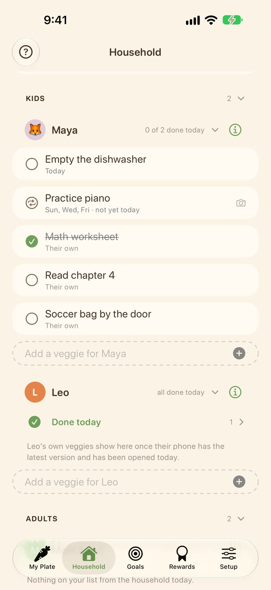

"Chores first, then screens" is an easy rule to say and a tiring one to police. You end up as the timer, the checker and the bad guy. The way out is to have the phone do the enforcing, so the answer to "can I go on my phone?" is on the phone already.

Veggies First has a household mode for this.

## How it works

One adult starts a household and adds each person with a code. From then on:

- **You hand out the chores.** On your phone, type a chore under your kid's name and it's on their plate at once. You can make repeating ones for the days you pick, and plan ahead for later in the week.
- **Their apps wait.** While a chore is left, the apps you've picked as dessert on their phone show a lock screen with the list.
- **Done means open.** Each chore they finish earns minutes, and a clean plate opens the apps for the rest of the day.

You see everyone's day on one screen: what's done, what's left, and when a kid's phone last checked in.

## You stay in charge of what's locked

A kid's dessert apps are picked on the kid's phone, and changing them asks for an adult's code. The code is four numbers, shown on your phone, and it works once. One a kid has seen stops working. If you're not in the room they can tap to ask, and your phone shows who's asking.

The kid's page keeps a history: every time the apps were changed, whose code was used, and any wrong code typed.

## "Did you really clean your room?"

A chore can ask for proof: a photo, a short video or a note. It lands on your phone and you approve it, approve part, or send it back. Part of the reward waits for your answer.

## Rules you set, and rules they keep

For each kid you can set how much a chore earns, how long a sitting is, the break between, how many passes they get and more. Or leave any of them for the kid to decide. An older kid can manage their own list as well. A younger one can be set to ask first: they send a chore they'd like to do, and you approve it and set what it pays.

## What it does for the arguing

The rule stops being you. It's the same every day, it's on the screen, and it opens the moment they finish. Kids also get something from the deal, which is a clear way to earn their time that doesn't depend on catching you in a good mood.

## Two things to know

Households are for ages 13 and up, and a parent or guardian agrees on a child's behalf when adding them. One Household plan covers up to six people.

## Try it

Start with two daily chores and the two apps they'd most like back. Veggies First is free to try for 14 days. The basics are in [How Veggies First works](/guides/how-veggies-first-works/).
