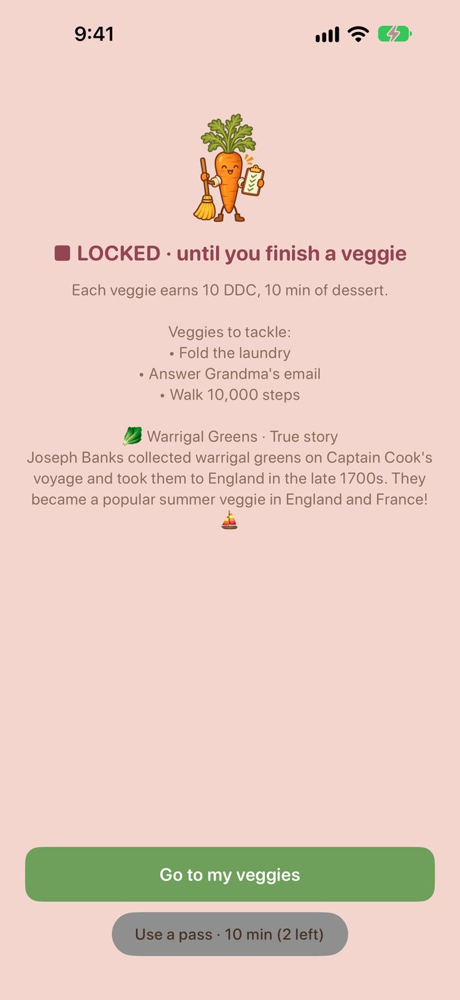

"Eat the frog" means doing your hardest, least wanted task first, before the day gives you a hundred reasons not to. Everyone agrees with it. Almost nobody does it, because the phone is right there offering something easier.

So the advice needs two things added: a list that puts the frog on top, and a phone that won't offer the easier thing until the frog is done.

## Put the frog at the top

In Veggies First you can drag to-dos into order. The top few are your focus: shown in bold, and listed first on the lock screen. Put the frog there the night before, when choosing it costs you nothing.

## Make it the thing between you and your phone

The apps you've marked as dessert stay locked while to-dos are left. Reach for one in the morning and you see the list, with the frog at the top.

You could do an easier to-do first and earn a few minutes that way. Fine. But the frog is still there at the top of the screen every time a session ends.

## Pay more for it

Turn on per-task rewards and make the frog a big one, paying double, or set your own number. The dull five-minute jobs can pay the standard. Now the fastest way to a long break is the task you'd normally save for last.

## Give it a deadline, if you need one

If "first" keeps sliding to "by tonight", Hardcore mode lets you give a to-do a time. Finish after it and the task still has to be done, but pays nothing. A frog due at 10 AM tends to get done in the morning.

## Cut it down to a first bite

If the frog is too big to face, it's really several to-dos. "Do taxes" becomes "find last year's return", "download the statements", "fill in page one". Each one pays when it's done, and the first is small enough to start.

## Don't let it hop to tomorrow

You can't swipe a to-do to tomorrow in the morning. That move only unlocks at your evening review time, and anything you push still counts against today. The frog can be moved, but not at 9 AM when you'd most like to.

## After the frog

The rest of the list feels lighter, and once it's clear your apps are open for the rest of the day with no meter. The worst part of the day is finished before lunch.

## Try it

Tonight, put tomorrow's frog at the top of the list and give it the big reward. Veggies First is free to try for 14 days. If starting is the real problem, read [How to stop procrastinating on your phone](/guides/stop-procrastinating-on-your-phone/).
