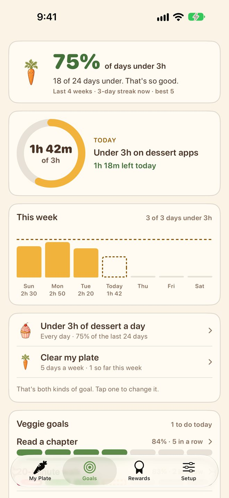

Sometimes you don't want a lock. You want to know how you're doing. Veggies First has goals for that: a number to aim at each day, and an honest record of how often you hit it.

## Three kinds of goal

- **Less dessert time.** Stay under a daily limit in the apps you've marked as dessert, like two hours. You choose the limit and which days it counts.
- **Clear my plate.** Finish every to-do so many days a week.
- **A veggie goal.** Track one repeating to-do, like push-ups every day, and how often it gets done.

Going over a limit locks nothing. It only shows in your history.

## What the page tells you

The page leads with what you got right: the share of the last four weeks' days you made your goal. Under that is today against your limit, and each day of this week as a bar.

Tap a goal for the last four weeks as a calendar, with a week-by-week summary. Your streak is there too, in smaller print.

## Praise first

The app is built to point at the good days. It doesn't make a broken streak the headline. "9 of 11 days under" is a truer picture than "streak: 0" on the morning after one long evening, and people who feel they're mostly winning tend to keep going.

If you'd rather be teased, turn on Hardcore mode and the page changes its tone. The numbers stay the same.

## It's fair about what counts

- Today joins the percentage at midnight, once the day is over.
- A dessert-time goal can skip days. Leave Saturday out if that's your day.
- Days with nothing planned, and days off, don't count for or against clearing your plate.
- The time comes from Apple's Screen Time, which reports in steps of about ten minutes, so the number runs a little behind.

## See it without opening the app

There are Home Screen and Lock Screen widgets for goals: a ring for today, your success rate, the week as bars, and a large calendar of the last eight weeks with a dot a day.

## If you do want it to lock

That's a switch too. In Hardcore mode, "Lock dessert at my goal's limit" locks your dessert apps until midnight once the day's time is used, clean plate or not, and no pass gets past it. It's off unless you ask for it.

## Goals alongside the rest

Goals don't replace the main rule of the app, to-dos first and then your apps. They sit beside it and answer a different question. The lock asks whether you've done your things today. The goal asks how your month is going.

## Try it

Set a limit a little under what you use now, and check the page in a week. Veggies First is free to try for 14 days. To track a habit the same way, see [Repeating to-dos](/guides/repeating-to-dos/).
