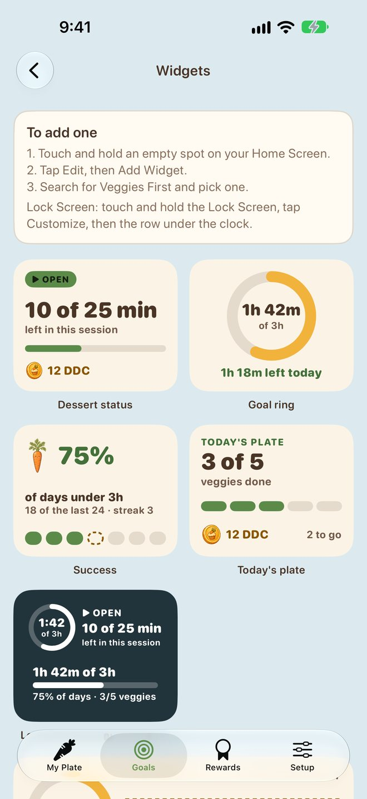

The best reminder of what you meant to do today is one you see every time you unlock your phone, before you've opened anything. Veggies First has twelve widgets for that, for the Home Screen and the Lock Screen.

## For "can I scroll yet?"

**Dessert status** is the bar from the top of the app, as a widget: green OPEN with your minutes, orange DESSERT BREAK counting down, red LOCKED, or purple PASS. It answers the question before you tap an app and hit a lock screen.

## For "what's left?"

- **Today's plate** shows how many to-dos are done and the coins you have.
- **Veggies and dessert** puts your plate on one side and your app time on the other.
- **The whole day**, a large one, has it all: app time, your plate, your next three to-dos with your focus first, and the habits you track.

## For "how am I doing?"

These follow a goal, like staying under two hours a day in the apps you scroll.

- **Goal ring**: today's time against your limit, and how much is left.
- **Success**: the share of recent days you stayed under.
- **Goal and the week**: today beside a bar for each day of this week.
- **Veggie goals**: up to three habits you track, each with its week.
- **Goal calendar**, large: a dot for every day of the last eight weeks. Green is a day you made it, a red ring is one you missed, and the dashed one is today.

## For the Lock Screen

A small ring, a status line and a bar sit under the clock, so you can see where you stand without unlocking.

## Adding one

Touch and hold an empty spot on your Home Screen, tap Edit, then Add Widget, and search for Veggies First. For the Lock Screen, touch and hold it, tap Customize, then the row under the clock.

Inside the app, the Goals tab has a Widgets page that shows every one with your own numbers, so you can choose before you add.

## Small print

- Each widget comes in one size. For a different size, pick a different widget.
- They follow the look you've chosen in the app.
- The minutes update when the app or Screen Time reports them, so during a session they can be a few minutes behind.
- A tap on any widget opens the app in the right place.

## Why bother?

Because the lock only speaks up when you try to open an app. A widget is there the rest of the time. Seeing "2 of 5 done" on the Home Screen a few times a day keeps the list in mind.

## Try it

Put Dessert status and Today's plate side by side on your first Home Screen page. Veggies First is free to try for 14 days. What the goal widgets track is explained in [Screen time goals: keep score without a lock](/guides/goals-and-streaks/).
