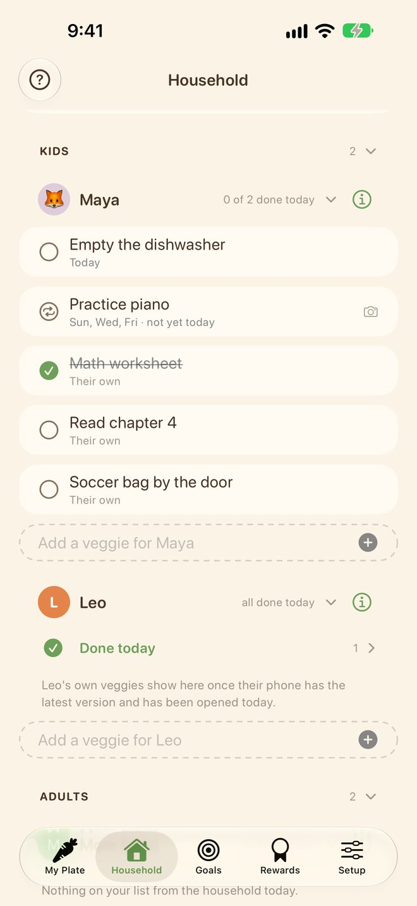

Kids follow screen time rules when the rules are clear, the same on Tuesday as on Saturday, and not up for debate every evening. They push against the fuzzy ones, the kind that depend on your mood or on who asks. So the work is in deciding the rules once and letting something else hold the line.

## Decide four things

1. **What comes first.** Homework, chores, practice: the short list that has to happen.
2. **Which apps wait.** Not the whole phone. The games and feeds.
3. **How much a finished job earns,** and how long one sitting can run.
4. **What a day off looks like,** so there's a real one and it isn't a daily negotiation.

## Let the phone hold them

In Veggies First, a household puts those four decisions on the kid's phone. Their to-dos land on their plate from yours. The apps you picked stay locked while anything's left, and each finished job earns minutes. Sittings come with a break after, and a clean plate opens everything for the day.

The settings are per kid. A 13-year-old and a 16-year-old don't need the same rules. Any row you leave on "Theirs to set" is the kid's own call, which is a good way to hand over control a piece at a time.

## Kids are clever, so plan for it

A few things kids try, and what happens:

- **Changing which apps are locked.** It asks for a parent code: four numbers from your phone that work once.
- **Guessing the code.** Wrong codes are written to the history on your phone.
- **Deleting a chore.** Chores from a parent can't be deleted on the kid's phone.
- **Saying it's done when it isn't.** Turn on proof and a chore needs a photo you approve.
- **Deleting the app.** That would lift the locks, so the app's Help gives you the iPhone setting that stops apps being deleted on a child's phone.

Every adult in the household sees the same history of who changed what.

## Give them a fair deal

Rules stick better when kids get something from them:

- They can **earn** time. A limit only takes it away.
- **Passes** cover the odd day they need in early.
- **Big days** reward the day they did far more than asked.
- On "Asks first" they can **suggest their own jobs** and you set what each pays.

A kid who can see how to get what they want has less reason to look for a way round.

## What you can see

Whether today's jobs are done, how many apps are locked and what they're called, and when the phone last checked in. You can't see what they do inside their apps. Kids never see an adult's plate.

## Try it

Sit down together and agree the four decisions before you set anything up. Veggies First is free to try for 14 days, and households are for ages 13 and up. Setting up chores is covered in [Chores before screen time](/guides/chores-before-screen-time/).
