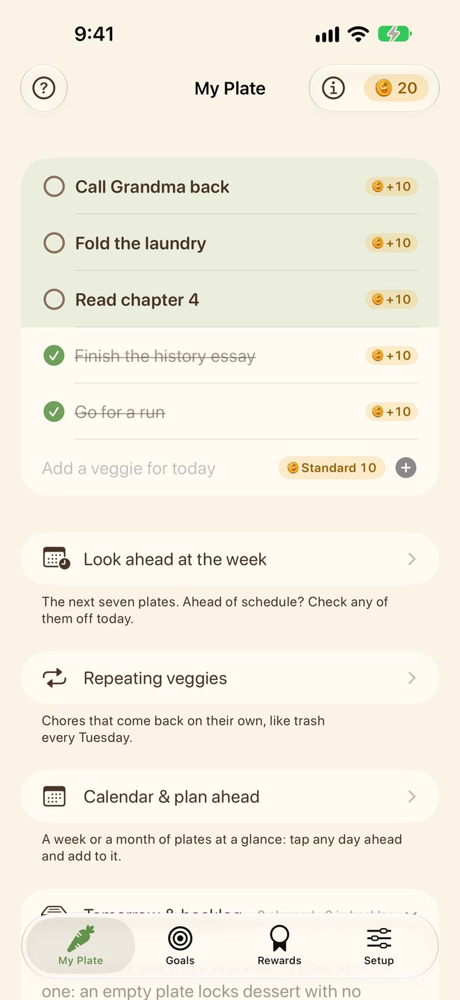

Veggies First is a to-do list for iPhone that's joined to your screen time. The apps you lose time in stay locked until you've done something on today's list. Finish the list and they're open for the rest of the day.

The name is the rule most of us grew up with: eat your veggies, then you get dessert.

## Veggies are your to-dos

Whatever has to happen today goes on your plate: the gym, the dishes, one chapter, the email you've been avoiding. You type it and hit return. Small and real beats big and vague.

## Dessert is the apps you scroll

You pick what counts as dessert: single apps, whole categories like Social or Games, or websites. Most people start with the two or three they really lose time to.

## What happens during the day

1. **While a veggie is left, dessert is locked.** Open a dessert app and you get a lock screen instead, with what's left on your list.
2. **Finish a veggie and you earn coins** (the app calls them DDC). One coin is one minute in a dessert app, counted as minutes you really use.
3. **Dessert comes in sessions.** When a session is used up, dessert takes a short break before the next one can start, so it stays a treat and doesn't swallow the afternoon.
4. **Clean plate? You're free.** Finish every veggie and every dessert app is open for the rest of the day, with no timer.

A bar at the top of the app says where you stand all day: open, on a dessert break, locked, or on a pass.

## It bends, but it holds

Life doesn't run to plan, so there's room to move:

- **Passes** open dessert without finishing a veggie, for the days you need one.
- **Weekend mode** is a day off with nothing to do, picked the day before.
- **A big day**, where you finish far more than usual, can end with dessert open even if one thing didn't happen.

And it's built so you can't undo it all in a weak moment. Changes to what a veggie earns or how long a session lasts start at midnight. An app you take off the dessert list stays locked until your plate is clean or midnight. A pass takes a deliberate hold, and you can't use two in a row.

## What it doesn't do

It never sees what you do inside an app. It uses Apple's Screen Time to do the locking, and Screen Time only reports minutes of use. It's for iPhone only.

## Try it

Setup takes about ten minutes: pick your dessert apps, put two or three veggies on today's plate, and tonight add tomorrow's. Veggies First is free to try for 14 days. If [doomscrolling](/guides/stop-doomscrolling/) is what brought you here, start with the two apps you scroll most.