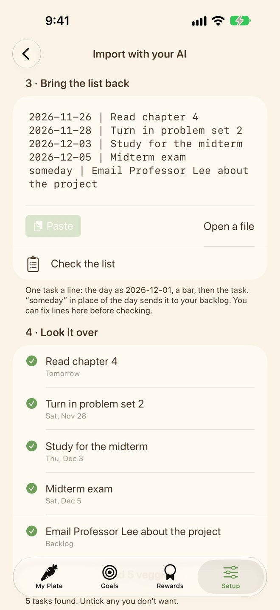

The slowest part of a new to-do app is typing everything in. Veggies First skips it: if the list already exists somewhere (a syllabus, a chore chart on the fridge, a project plan), the AI you already use can read it and the app turns the answer into to-dos on the right days.

## The three steps

1. **Copy the prompt.** In Setup, open Import with your AI and tap Import a list, then Copy the prompt. It tells your AI exactly how to write the tasks.
2. **Give it to your AI.** Paste the prompt into Claude, ChatGPT, Gemini or whichever you use, and add the photo, PDF or text.
3. **Paste the answer back.** Copy what the AI returns, come back to the app and tap Paste, or open the file if it gave you one. Then tap Check the list.

## You check it before anything is added

Nothing goes on your plate until you've looked. Each task shows the day it will land on, or Backlog for the someday items. Untick any you don't want, then tap Add.

Two kinds start unticked so they can't sneak in: a task whose day has already passed, and one that's already on your plate. Tick a past one and it goes on today.

## The format is simple enough to fix by hand

Each line is a day, a bar and a task, like `2026-12-01 | Read chapter 4`. Write "someday" for the day and it goes to your backlog. If the AI gets a date wrong you can edit the line yourself, or type a few lines from scratch.

The prompt has today's date in it, so your AI can work out "next Friday". Copy a fresh one each time.

## What about privacy?

The app doesn't send your photo or your list anywhere. You give them to your own AI, in its app, on your terms. Veggies First only reads the text you paste back.

## What happens next

Imported tasks are ordinary veggies. Each pays the usual reward, which you can change with a swipe. Each waits on its day, and on that day the apps you've marked as dessert stay locked until it's done. A semester of due dates becomes a semester of days where the work comes first.

One import brings in up to 200 tasks.

## Good things to import

- a class syllabus, one class at a time
- a weekly chore rota for the house
- a training plan
- a moving or wedding checklist

## Try it

Start with one document you already have. Veggies First is free to try for 14 days. For a student's whole setup, see [How to study without your phone distracting you](/guides/study-without-phone-distractions/).
