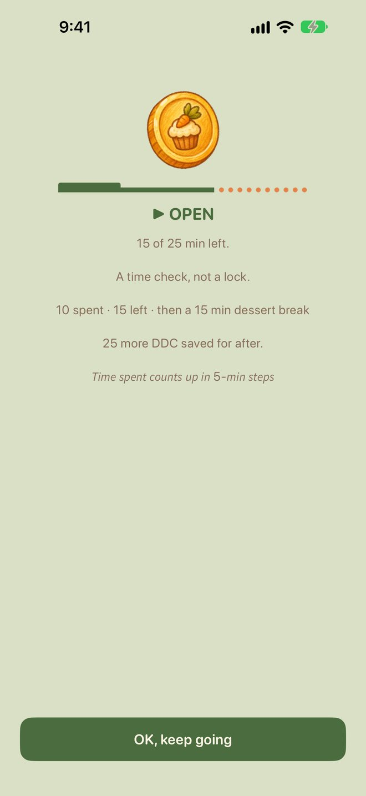

Short videos are built into apps you use for other things too, so there's no clean way to block just that part. What you can control is the app around them: when it opens, and how long you stay each time. Do that for every app that has a feed, or you'll just move from one to the next.

## One rule for all of them

In Veggies First you mark apps as "dessert": Instagram, YouTube, TikTok, or the whole Social and Entertainment categories at once. Websites can go on the list as well, which covers the browser versions.

They then work as a set. While a to-do is left on today's list, all of them show a lock screen. The minutes you earn are shared across all of them. If Instagram's session runs out, YouTube's is out too.

## Earn the sitting

Each to-do you finish pays coins, and a coin is a minute. So Reels come after the laundry, and they're a break you've earned. They aren't the way you avoid the laundry.

## Give the sitting an end

Short videos are hard to stop because every one is a fresh start. Veggies First runs your time in sessions. When one is used up, there's a break before the next. You look up, and the lock screen shows what's left to do.

A time check can also appear mid-scroll to say how far in you are. One tap dismisses it.

## Put a number on it

If you'd like a daily total, set a goal, for example under 90 minutes a day across your dessert apps. The app keeps score with a calendar of the last weeks. Going over locks nothing unless you turn on the hard stop in Hardcore mode, which locks them until midnight once the time is used.

## "But I use YouTube for other things"

Two ways to handle that:

- **Use passes.** A pass opens your apps for a while without finishing a to-do, for the tutorial you need now. It takes a short hold to use, and you get a limited number a day.
- **Finish early.** A clean plate opens everything for the rest of the day, so the long video you wanted to watch is a good reason to get the list done.

## What the iPhone offers by itself

You can [set a daily time allowance in Screen Time](https://support.apple.com/guide/iphone/set-schedules-and-time-allowances-iphb0c7313c9/ios) for a category of apps. That caps the total. It doesn't tie the time to anything you've done or put an end on each sitting, and those are the two things Veggies First adds.

## Try it

Mark the Social category as dessert, add YouTube, and put three things on today's list. Veggies First is free to try for 14 days. The same setup for one app: [How to cut down on TikTok without deleting it](/guides/cut-down-on-tiktok-without-deleting-it/).
