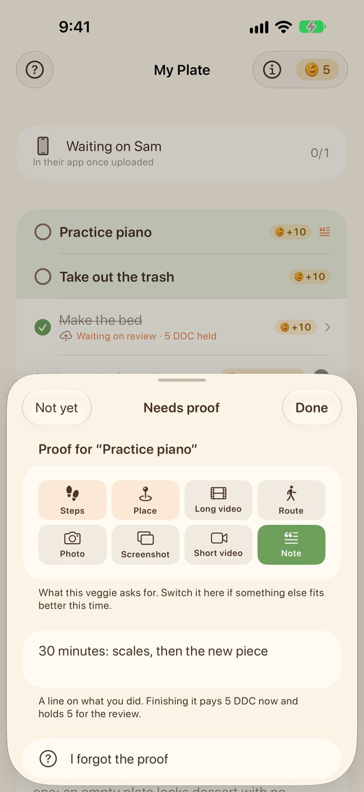

An accountability partner works because somebody will look. A promise to yourself is easy to fudge. A photo of the finished thing, sent to a friend, is not. Veggies First has this built in, and your friend doesn't have to install anything.

## How proof works

Proof is off until you turn it on. Then you choose: every to-do needs proof, or only the ones you flag.

Finish a flagged veggie and a sheet opens asking for the proof: a photo, a short clip, or a written note. It goes to your reviewer.

Part of that veggie's coins are held back until the reviewer answers. They can approve it, approve part, or decline, and send a note back. You set how much is held.

## Your friend doesn't need the app

There are three ways to add a reviewer: show them your QR code if they have Veggies First, scan theirs, or type a name and phone number for someone who doesn't.

Someone without the app gets a link by text. It opens a web page that shows what's waiting and takes their verdict. That's all they do.

If you both use the app, you can review each other. Their proofs land in a Reviews tab on your phone.

## It keeps itself moving

- A reminder can nudge you daily while something's still waiting on your reviewer, with a message ready to send.
- With more than one reviewer, you pick who sees each proof, or everyone.
- A proof nobody answers eventually expires, and its held coins are gone. So choose a friend who'll look.

## Some to-dos prove themselves

A step goal is finished by your step count, and a place goal by the minutes you spend somewhere like the gym. Those can't be ticked by hand, so they need no reviewer and pay in full.

## What your reviewer can and can't see

They see what's on your plate, whether it got done, and the proofs you send. Photos and clips are deleted from the server the moment they answer, and no later than two days after they were taken. Nobody sees what you do inside your apps, including us.

## Who to ask

Someone who'll be kind but not soft. A friend with the same goal is ideal, because then it runs both ways. And start with one or two to-dos that matter, like the workout or the study hour. Not every dish needs a witness.

## Try it

Flag the one to-do you most often skip and send a friend the link. Veggies First is free to try for 14 days. For the other ways the app keeps you honest, see [An app blocker that's hard to cheat](/guides/app-blocker-you-cant-cheat/).
