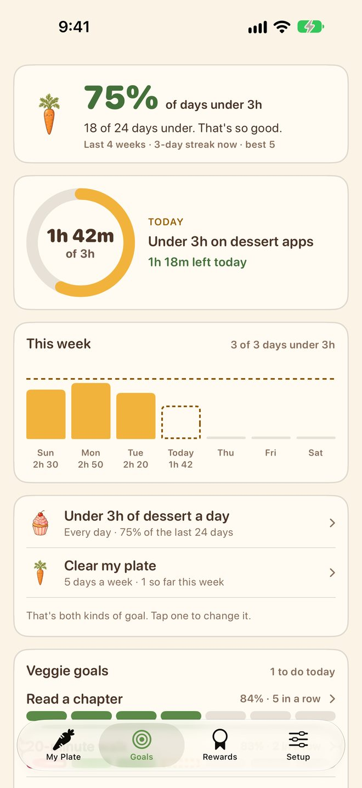

You get a habit to stick by making it show up without you having to remember. If the workout is on today's list when you wake up, it's a thing to do. If you have to think of it first, it's still only an intention.

In Veggies First that's a repeating veggie.

## Set it once

A repeat puts itself back on your plate on its days, the way a calendar event repeats. You pick the pattern:

- daily, or every weekday,
- weekly, on any mix of days,
- monthly or yearly,
- with an end date if it has one.

You can also turn a to-do that's already on your plate into a repeat.

Each copy lands the day before it's due, so you see it when you plan tomorrow.

## A habit with something riding on it

A repeat is a normal veggie on the day. That means the apps you've marked as dessert stay locked until it's done, and finishing it earns minutes. Ten push-ups stops being a nice idea and becomes one of the things between you and your feed.

## Skip one without breaking it

Deleting one copy skips only that day. Changing the pattern affects copies from tomorrow on, and today's stays as it is. If you make a new repeat that's due today and didn't mean to start today, one tap starts it with the next one, with nothing counted against you.

## Keep notes that come back

Each repeat has notes. Write one ("got to 12 this time", "use the blue folder") and it's kept with its date. The next time the repeat comes round, there's what you wrote last time. It's handy for weekly jobs you only half remember how to do.

## Turn it into a goal

Any daily or weekly repeat can be tracked as a veggie goal. The Goals tab then shows its week, how often you've done it and your run, and it can go on a Home Screen widget.

A veggie goal only counts on the days that repeat comes round, so a Monday, Wednesday and Friday habit isn't marked down for Tuesday.

## Repeats that tick themselves

Two kinds don't need a tap. A step goal finishes when your step count gets there. A place goal pays for minutes spent somewhere, like the gym. Make either one repeat and the habit is counted for you.

## Start small

Use one or two repeats that take five minutes. A list full of daily repeats becomes a wall, and the point is a plate you can clear. Add more once the first has run for a couple of weeks.

## Try it

Make one daily repeat tonight, small enough that you'd feel silly skipping it. Veggies First is free to try for 14 days. Where repeats show up each evening: [Plan tomorrow tonight](/guides/plan-tomorrow-tonight/).
