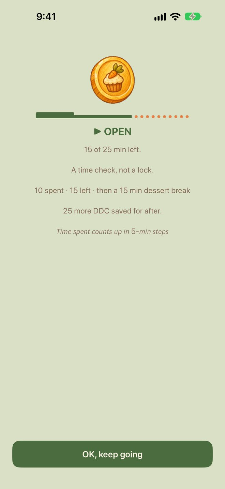

Do you lie down with your phone for an hour and look up to find it's dark out? If so, the answer probably isn't to stop resting. It's to give the rest an end, and Veggies First can do that for you.

Veggies First is an iPhone to-do list joined to your screen time. The apps you scroll stay locked until you've done something on your list, each thing you finish earns time in them, and once the list is clear they're open for the rest of the day. You still get to rot. It comes after something, and it stops somewhere.

## Rest isn't the problem

An afternoon on the couch doing nothing is fine. Sometimes it's just what a body wants. And a feed is fun, which is why you opened it.

The trouble is only when the hour you had in mind turns into four, and the laundry, the email and the walk you half meant to take are still waiting at 9 PM. By then it has stopped feeling like rest.

A feed doesn't help with this, because it has no last page. A film ends. A feed leaves the stopping to you, at the moment you least feel like doing it.

## How Veggies First does it

You put the day's to-dos on your plate (the app calls them veggies) and pick the apps you rot in as "dessert": single apps, whole categories or websites. Four things then give the afternoon a shape.

**Something small comes first.** While a to-do is left, a dessert app shows a lock screen with your list on it. Finish one and you earn coins (the app calls them DDC). One coin is one minute in a dessert app. On a lazy day the list could be two small things: start the laundry, answer one email.

**The scroll comes in sittings.** Open a dessert app and a session starts. When it's used up, dessert takes a short break before the next one can begin. That break is the last page the feed doesn't have: there's nothing to scroll, so you look up. If you're in the middle of a video, you can buy a minute or two to finish it first.

**A time check says how far in you are.** During a session a screen can pop up with the minutes you've spent and what's left. It's a nudge, and one tap puts you back.

**Clear the list and the meter is gone.** Finish every to-do and dessert is open for the rest of the day. The evening on the couch is yours, with nothing waiting behind it.

## For the days you want to do nothing at all

Some days should be a write-off, and the app has room for those.

- **Weekend mode** is a whole day off: no to-dos, dessert open all day. You get a few a week, on any day you like, and you pick one the day before.
- **An easy day.** If there's nothing on your plate, the lock screen offers "I have nothing to do, life is easy", and dessert opens for the day. Add a to-do later and the usual lock is back.
- **An evening window**, if you turn it on, opens your apps for an hour or two every night, whether the list is done or not.

How long a session and a break last is yours to set. Changes start at midnight, though, so three hours in you can't quietly stretch the session you're on.

## What the iPhone does by itself

You can [set a time allowance in Screen Time](https://support.apple.com/guide/iphone/set-schedules-and-time-allowances-iphb0c7313c9/ios) for a category of apps, such as social media. That caps the day's total. Veggies First works from the other end: the apps open because you did something, and the time arrives in sittings, each with a stopping point.

## Try it

Before your next lazy afternoon, you could put two small things on your plate and pick the one or two apps you sink into as dessert. Then rest as planned. Veggies First is free to try for 14 days.

For the whole picture, see [How Veggies First works](/guides/how-veggies-first-works/). If it's less the couch and more the feed, try [How to stop doomscrolling](/guides/stop-doomscrolling/).
