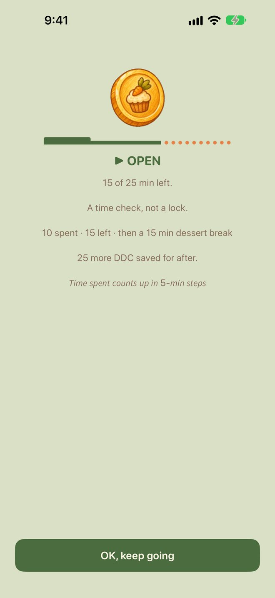

The hardest part of putting the phone down is that nothing tells you when. A show has an episode's end. A feed just keeps going. Veggies First adds the missing end: app time comes in sessions, and after each one there's a break.

## How a session works

You earn coins by finishing to-dos, and a coin is a minute in the apps you've marked as dessert. Open one and a session starts. It spends your coins as you go, up to the session's length.

When the session is used up, dessert takes a break. The apps lock, the screen turns orange, and it tells you when they're back.

## The break is the feature

During the break there's nothing to scroll, so you look up. Often that's all it takes to notice the time. The lock screen lists what's still on your plate, which is a useful thing to see right then.

When the break ends, any coins you have left start the next session. With none left, dessert stays locked until you finish another to-do.

## You set the three numbers

- how many coins a to-do pays,
- how long a session can run,
- how long the break is.

They're sliders. Someone who wants a 10 minute look between jobs sets it up differently from someone who wants one long sitting in the evening.

Changes start at midnight. You can't make the break shorter while you're in the middle of one. That delay is deliberate: you set the rules with a clear head, and the version of you who wants one more video can't change them.

## It's fair about the edges

A few details stop it feeling petty:

- **A peek doesn't burn a session.** One that sits unused resets after a while.
- **Mid-video?** For a few minutes after a session ends, you can buy one or two more minutes to finish what you were watching, once a session. The break then starts in full.
- **A session that ends before you used any of it** goes back in the bank.
- **A time check** can pop up during a session to say how far in you are. It's a nudge, and one tap dismisses it.

## Once the list is done, no more meter

Sessions and breaks only apply while you still have to-dos left. Clear the plate and dessert is simply open until midnight. The breaks are there for the hours when you still have things to do.

## Try it

Start with the app's own settings for a few days before you move the sliders. Veggies First is free to try for 14 days. How the coins are earned is in [Earn your screen time instead of rationing it](/guides/earn-screen-time/).
