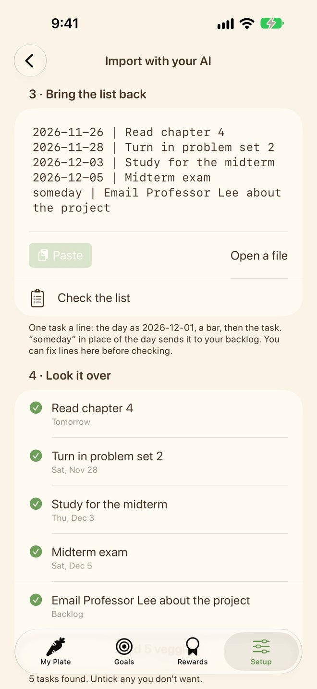

You don't need to give up your phone to study. You need the apps that pull you away to be closed until a block of work is done, and open, without guilt, once it is. Veggies First is built for that trade, and a lot of it suits a student's week.

## Turn the syllabus into a list

The semester's due dates are already written down, in a PDF you looked at once. Veggies First can pull them in with whatever AI you use. The app gives you a prompt to copy; you paste it into your AI with the syllabus, a photo or a screenshot; it hands back a list; you check it over in the app and tap Add.

Each task lands on its day, up to 200 at a time. The app doesn't send your file anywhere. What you give your AI is between you and it.

## Break the work into blocks

"Study for the exam" isn't a to-do. "Chapter 4 problems, 1 to 10" is. Each finished veggie pays coins, and a coin is a minute in the apps you've locked. Three blocks mean three payouts.

If one task is much heavier than the rest, give it a bigger reward. A problem set can pay double what "reply to the group chat" does.

## Lock what distracts you, not everything

You choose the apps: single ones, whole categories like Social or Games, or websites. Leave your notes, your calculator and your music alone. While a study block is still on the list, the locked apps show your list in place of a feed.

## Take the break you earned

When a block is done, the minutes are yours. They come in sessions with a short break after each, which works much like a study timer: work, scroll a little, back to work. Nothing asks you to feel bad about the scrolling. It's what you worked for.

Finish everything on the day's list and the apps are open for the rest of the night.

## For the days that go sideways

- **An evening open window** opens your apps for an hour or two at a set time, finished or not. Good for the nights you planned too much.
- **Weekend mode** is a full day off, picked the day before.
- **A big day** rewards you for doing far more than usual, even if one thing got missed. Finals week has a few of those.

## Study with a friend

Add a classmate as a reviewer and a study block can ask for proof, like a photo of the finished problem set. They say whether it counts. If they use the app as well, you can check each other.

There's a student and teacher discount on the plan, checked with a school email.

## Try it

Import one class's syllabus and lock the two apps you open most in the library. Veggies First is free to try for 14 days. More on getting started on hard things: [How to stop procrastinating on your phone](/guides/stop-procrastinating-on-your-phone/).
