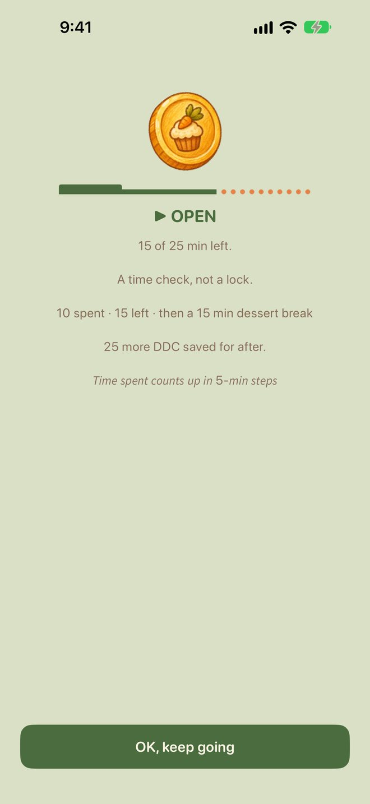

You can lose forty minutes in an app without ever deciding to. The time check is Veggies First's answer to that: a screen that appears while you're scrolling and says, in effect, "you're this far in". It doesn't stop you. It only makes sure you know.

## What it looks like

During a session, a green screen marked OPEN comes up over the app. Under the coin is a bar: the thick part is the time you've spent, the line is what's left of the session, and the orange dots are the break that follows.

Tap OK and you're back where you were.

## Why a nudge and not a lock

The app already has locks: one while to-dos are left and you have no coins, and one for the break after a session. The time check does a different job. You've earned this time and nobody's taking it away. The check only turns scrolling you hadn't noticed into scrolling you chose.

Often you tap through. Sometimes you see the number, think "that's enough", and close the app with minutes to spare. Either is fine.

## You decide how often

In Setup you can:

- turn the time check off altogether,
- show it only at the start of a session,
- or bring it back every 5 to 30 minutes of use.

Someone who finds it helpful sets it tight. Someone who finds it nagging sets it wide or switches it off. The app explains the screen with a picture before you choose.

## On every open, if you want

Out of the box, the check is tied to time used. If you'd like it every single time you open one of your apps, the app walks you through a one-step Shortcuts automation that does it, with screenshots. One automation covers all your dessert apps.

With that on, there's a bonus: the first time you open a dessert app after finishing everything, you get a green PLATE CLEAN screen. It's a small reward for the day.

## For kids' phones

In a household, an adult can set the time check for a kid's phone, or leave it for the kid to decide.

## Try it

Leave the time check on for the first week, at whatever interval feels mildly annoying. That's usually the right one. Veggies First is free to try for 14 days. How sessions and breaks fit around it is in [A feed never ends. Sessions and breaks give it an end](/guides/sessions-and-dessert-breaks/).
